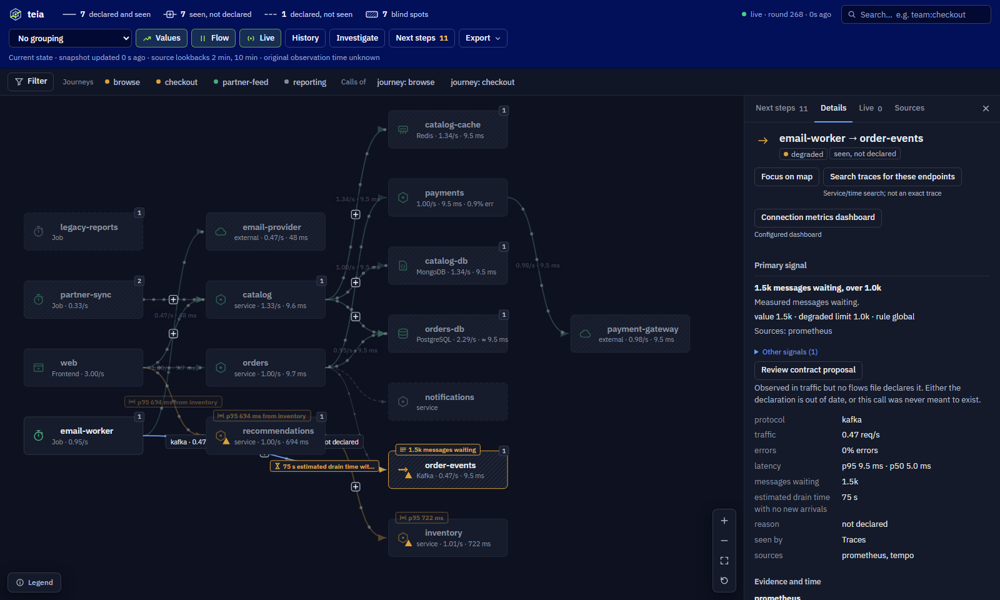
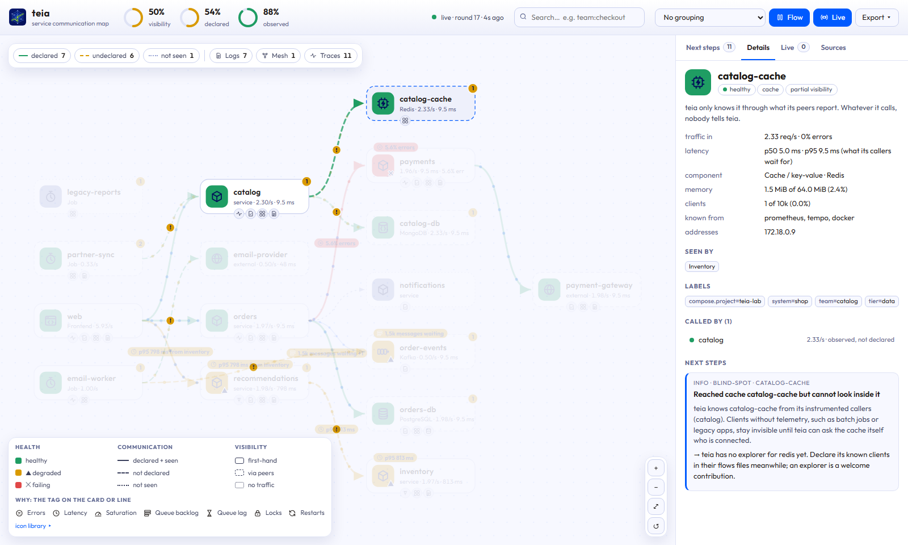

<p align="center">
  <picture>
    <source media="(prefers-color-scheme: dark)" srcset="docs/assets/logo-dark.svg">
    
  </picture>
</p>

<p align="center">
  <a href="https://github.com/nilum-br/teia/actions/workflows/ci.yml"></a>
  <a href="LICENSE"></a>
  <a href="go.mod"></a>
  <a href="plugins/grafana"></a>
</p>

**Your architecture diagram is lying somewhere. teia tells you where, and what to do about it.**

teia maps who talks to whom across your platform from the telemetry you **already** have (traces, mesh metrics,
eBPF flows, access logs, the databases themselves), compares it with what teams *declared*, and, unlike a plain
service map, tells you exactly where it is blind and which grant, adapter or instrumentation would let it see more.
It runs as a single binary on Linux, macOS and Windows, and shows up where your team already looks: **Grafana**.

> _teia_ is Portuguese for "web": the mesh of threads that holds everything together.

[Português](README.pt-BR.md)

[October 2026 candidate guide (Português)](docs/candidate-guide.md) · [Validation and task status](docs/roadmap.md)


## Why

Service maps are established in Grafana, Kiali, Hubble and APMs. teia focuses on three questions together:

- **Drift.** Which communications happen that nobody declared, and which declared ones never happen?
- **Coverage.** How much am I *not* seeing, and what exactly would fix that?
- **Contract.** Where is the reviewed list of "A may call B on port X, because Y" that security, network and platform teams can all work from?

teia merges three layers into one graph:

| Layer | Where it comes from |
|---|---|
| **Declared** (intent) | `Flows` files next to each service's `catalog-info.yaml` |
| **Observed** (reality) | whatever the platform already runs: OpenTelemetry / Tempo, Istio / Linkerd, Beyla / Hubble / Retina, Loki access logs, Kubernetes or Docker inventory, the databases |
| **Drift** | ghost: observed but undeclared · stale: declared but not observed |

The **advisor** then crawls outwards ("fiando a teia") and explains every blind spot with a concrete next step:

```text
[warning/permission] Reached database orders-db but cannot see who else connects to it
    Right now 2 session(s) are hidden, from roles: orders (1), reports (1).
    -> GRANT pg_monitor TO "teia";
```

Apply it and the next round finds the legacy job nobody instrumented, then tells you how to see inside it.

## Agnostic by design

- **No mesh required, no agent shipped.** A mesh is one signal among several; see [docs/sources.md](docs/sources.md).
- **Auto-detection.** Point teia at Prometheus and it finds service graph metrics, Istio, Linkerd, Beyla/OBI, Hubble and Retina on its own (10 presets). `teia detect` prints what your platform offers and a starting config.
- **Anything else** becomes edges through a PromQL or LogQL query plus a label mapping.
- **Mixed platforms are normal:** part Istio, part OpenTelemetry, part nothing. Each edge records which signals saw it, and "unknown callers" are explained per signal.
- **Identity you can trust:** IPs are resolved through inventory, and recycled IPs are never attributed to the wrong workload.

## What you see

The map, in Grafana (`nilum-teia-panel`) or in teia's own UI, is the same component:


- **Golden signals, and why:** each card and line shows its traffic, p95 latency and error rate. Amber or red is the worst signal past its limit, and a tag on the card or line says which one and where it most likely comes from, so you see the cause at a glance, not only the colour: `p95 900 ms from inventory`, `4.4% errors`, `3 on locks held by legacy-reports`, `1.5k messages waiting`, `7 min behind`, `93% memory`.
- **Every kind of component:** services (errors, latency, CPU throttling, memory, restarts), relational databases (connections, sessions waiting on locks and who holds them), MongoDB, Redis (memory, clients) and queues (Kafka lag in messages and in time, consumers without progress, RabbitMQ backlog), read from the exporters you already run.
- **Live traffic:** dots travel along each communication at its speed, and red dots are errors. Updates arrive live (Server-Sent Events, or the dashboard refresh in Grafana).
- **Drift and visibility:** dashed means undeclared, dotted means declared but not seen; card borders say how first-hand teia's view is.
- **One [icon library](docs/icons.md):** microservices, relational and document databases, caches, Kafka streams, queues, gateways, jobs, external SaaS. The technology is detected from spans, images or labels.
- **Journeys and filters:** show one journey on its own, in a frame, with ports where it is entered and where it leaves, and why it is red. teia finds the journey label your services already carry (`journey`, `app.kubernetes.io/part-of` or `system`). The same Filter narrows the map by any label, health, kind of component or technology. See [docs/journeys.md](docs/journeys.md).
- **Investigation workspace:** focus on a bounded neighbourhood or a directed path and read it as a table, compare two captures with the differences marked on both maps, follow one sampled operation from traces, see how each name was resolved, and turn an undeclared communication into a reviewable contract proposal. See [docs/investigation.md](docs/investigation.md).
- **Values on the lines:** each line says its traffic and p95 (`1.8/s · 9.5 ms`); an amber or red line says why instead. `V` toggles them.
- **Labels:** group by `team`, `system`, `k8s.namespace` or any label; search with `team:checkout`, `tech:kafka`, `journey=checkout`.
- **Next steps, live feed, export** (PNG, SVG, flow matrix CSV for firewall requests).
- **Keyboard and screen readers:** every card and control is reachable with Tab; `F` fits, `/` searches, `J` opens the filters, `V` toggles values on lines, `Space` toggles the animation, which also follows the reduced-motion setting.

| Amber or red says why, and where it comes from | Group by any label, in dark or light |
|---|---|
|  |  |
| **A queue says how much waits and how far behind** | **A cache or database says how full it is** |
|  |  |

Views are shareable links: `?journey=checkout`, `?filter=k8s.namespace:shop,health:failing`, `?group=team`, `?q=kind:database`, `?select=orders-db`, `?theme=light`, `?flow=1`, `?values=0`, `?legend=icons`.


<p align="center"></p>

Changes also go out as **webhooks** (JSON or Slack) and **Prometheus metrics** (`/metrics`) for alerting.

## How it works

<p align="center"></p>

teia is read-only and keeps no database: every interval it asks each source what it saw, merges the answers into
one graph with stable identities, compares it with the declared flows, scores health and coverage, and asks the
advisor what would make the picture more complete. The result is served as JSON, a live stream, metrics and webhooks.

## Try it in 5 minutes

You only need Docker (Linux, macOS or Windows). The lab is a small shop with the mix real platforms have: part
OpenTelemetry, part Istio mesh without OpenTelemetry, a managed Kafka and MongoDB seen only through client spans, a
third-party gateway, Redis, PostgreSQL, and jobs nobody instrumented. It also has one problem of each kind, so the
map has something to explain: payments fails some calls, inventory answers slowly, a consumer is behind, and the
end-to-end check takes a lock on a table.

```sh
docker compose -f lab/compose.yaml up -d --build
```

| What | Where |
|---|---|
| **Grafana with the teia panel** | http://localhost:3480/d/teia-overview |
| teia's own UI | http://localhost:8480 |
| Prometheus | http://localhost:9480 |

Follow the advisor, like you would in production:

```sh
docker compose -f lab/compose.yaml exec teia teia discover          # what teia sees and what it misses
docker compose -f lab/compose.yaml exec orders-db psql -U postgres -d orders -c 'GRANT pg_monitor TO teia;'
docker compose -f lab/compose.yaml exec teia teia discover          # the hidden legacy job shows up
docker compose -f lab/compose.yaml exec teia teia export matrix --lang pt-BR --declared-only
docker compose -f lab/compose.yaml run --rm e2e                     # the end-to-end check CI runs
```

Behind a TLS-inspecting proxy? Drop its CA as a `.crt` in `certs/` before building.

## Use it in your Grafana

Four steps, nothing to change in your services. teia reads the Prometheus, Tempo and Loki you already run. The
panel then finds journeys, teams and namespaces in the labels your workloads already carry.

**1. Run teia where it reaches your telemetry.** `teia detect` probes what you give it and writes a starting config:

```sh
docker build -t teia .     # releases will ship ghcr.io/nilum-br/teia
docker run --rm teia detect --prometheus http://prometheus:9090 --tempo http://tempo:3200 --loki http://loki:3100 > teia.yaml
docker run -d --name teia -p 8480:8080 -v "$PWD/teia.yaml:/etc/teia/teia.yaml:ro" teia
```

Add `--kubernetes` or `--docker` to `detect` so teia also knows the workloads that emit nothing. Open
http://localhost:8480: if the map is there, teia is reading your telemetry.

**Running on Kubernetes?** Use the [Helm installation guide](docs/kubernetes.md): build/push the image until the
first release, create an API token Secret, and point `config.sources` at your telemetry in `my-values.yaml`:

```sh
helm upgrade --install teia ./charts/teia -n teia --create-namespace -f my-values.yaml
helm test teia -n teia
```

The chart runs one read-only pod with inventory permissions. It installs no operator or CRD. Grafana in the same
cluster can use `http://teia.teia.svc:8080` as the data source URL in step 3. The guide explains RBAC, flows files,
token rotation and the optional Ingress and ServiceMonitor.

**2. Install the panel plugin** (`nilum-teia-panel`). Until it is signed and in the catalog, build it and load it as
an unsigned plugin:

```sh
docker run --rm --user "$(id -u):$(id -g)" -e npm_config_cache=/tmp/npm -v "$PWD:/repo" -w /repo/plugins/grafana node:26.12.0-trixie sh -c "npm exec --yes --package=npm@12.2.0 -- npm ci && npm run build"
cp -r plugins/grafana/dist /var/lib/grafana/plugins/nilum-teia-panel
```

```ini
# grafana.ini (or GF_PLUGINS_ALLOW_LOADING_UNSIGNED_PLUGINS=nilum-teia-panel)
[plugins]
allow_loading_unsigned_plugins = nilum-teia-panel
```

Restart Grafana. With the Helm chart, mount `dist/` at the same path, or, from the first release on, list the zip
under `plugins:`.

**3. Add a data source that reads teia.** Install the [Infinity](https://grafana.com/grafana/plugins/yesoreyeram-infinity-datasource/)
data source and give teia's address once, here. Grafana's server calls teia, so use an address Grafana reaches:

```yaml
# provisioning/datasources/teia.yaml
apiVersion: 1
datasources:
  - name: teia
    uid: teia                      # the dashboard looks for this uid
    type: yesoreyeram-infinity-datasource
    access: proxy
    url: http://teia:8080          # your teia
    jsonData:
      allowedHosts: ["http://teia:8080"]
      # with auth.token on teia:
      # httpHeaderName1: Authorization
    # secureJsonData:
    #   httpHeaderValue1: Bearer ${TEIA_TOKEN}
```

**4. Import the dashboard.** In Grafana, go to Dashboards → New → Import and upload
[`lab/grafana/dashboards/teia.json`](lab/grafana/dashboards/teia.json). Its queries hold paths only, so it works
against any teia the data source points to.

That is it. The **Filter** on the panel lists your journeys, namespaces, teams, health and technologies from the data
itself. Panel options set where it opens:

- **Journey** takes a value or a variable, such as `${journey}`; links like `?var-journey=checkout` work.
- **Journey label** names another label, when yours is not `journey`, `app.kubernetes.io/part-of` or `system`.
- **Group by label** sets the first grouping.

More in [plugins/grafana](plugins/grafana/README.md), including a direct mode that streams from teia without
queries.

Rebuilt the plugin without changing its version, and Grafana still shows the old panel? Grafana lets browsers keep
plugin files for an hour under their version: reload with Ctrl+Shift+R. Releases change the version, so this only
happens with local builds. The lab stamps each build with its own version.

## Install

- **From source** (today): `go build ./cmd/teia` (Go 1.27+). Docker and Kubernetes endpoints follow `DOCKER_HOST` / kubeconfig, including Docker Desktop, Colima, OrbStack, Podman and Windows named pipes.
- **Releases** (from the first tag on): binaries for Linux, macOS and Windows (amd64, arm64), a multi-arch image at `ghcr.io/nilum-br/teia` and the Grafana panel zip.
- **Grafana panel:** see [plugins/grafana](plugins/grafana).
- **Kubernetes:** [Helm chart and deployment guide](docs/kubernetes.md). Releases also package the chart and publish
  it to `oci://ghcr.io/nilum-br/charts/teia`, with the same version as the image.

Then `teia detect` prints what your platform offers and a starting `teia.yaml`, and `teia serve` runs the API and
the UI. Before exposing the API beyond localhost, set `auth.token` (and `cors.allowedOrigins` for the Grafana
panel's direct mode): see [Configuration](docs/configuration.md) and [Exposing the API](docs/architecture.md#exposing-the-api).

## Declaring flows

`Flows` is a **file format, not a Kubernetes CRD**. `apiVersion` and `kind` identify the format; do not run
`kubectl apply` on this file. Keep it in the service's repository. On Kubernetes the chart mounts these files
from `flows` or `flowsConfigMap`, and teia re-reads them each round. See [how to supply flows](docs/kubernetes.md#flows-files-not-a-crd).

```yaml
apiVersion: teia.nilum.io/v1alpha1
kind: Flows
metadata:
  name: orders
spec:
  owner: component:default/orders
  egress:
    - to: component:default/payments
      protocol: http
      port: 8080
      reason: charge the customer
    - to: resource:default/orders-db
      kind: database
      protocol: postgresql
      port: 5432
      reason: persist orders
```

Nobody should write these from scratch: for a service without a file, the advisor generates one from observed
traffic. See [docs/flows-spec.md](docs/flows-spec.md).

## Docs

[Signals and sources](docs/sources.md) · [Configuration](docs/configuration.md) · [Kubernetes / Helm](docs/kubernetes.md) · [Architecture](docs/architecture.md) ·
[Journeys](docs/journeys.md) · [Investigation](docs/investigation.md) · [Sampled operations](docs/operations.md) ·
[Identity resolution](docs/identity-resolution.md) · [Contract proposals](docs/review-proposals.md) · [Advisor rules](docs/advisor.md) ·
[Icon library](docs/icons.md) · [Flows spec](docs/flows-spec.md) · [Roadmap](docs/roadmap.md) · [Landscape](docs/landscape.md)

## Status

v0, moving fast. What works today is exercised end to end by the lab check in CI. Next: Backstage plugin
(entity card plus catalog relations), `teia diff` comments on pull requests, a teia data source for Grafana, and
more database explorers.

## Contributing and license

Issues and PRs welcome; see [CONTRIBUTING.md](CONTRIBUTING.md), and report vulnerabilities privately as described in
[SECURITY.md](SECURITY.md). Apache-2.0. Built by [Nilum](https://nilum.com.br) and contributors.
