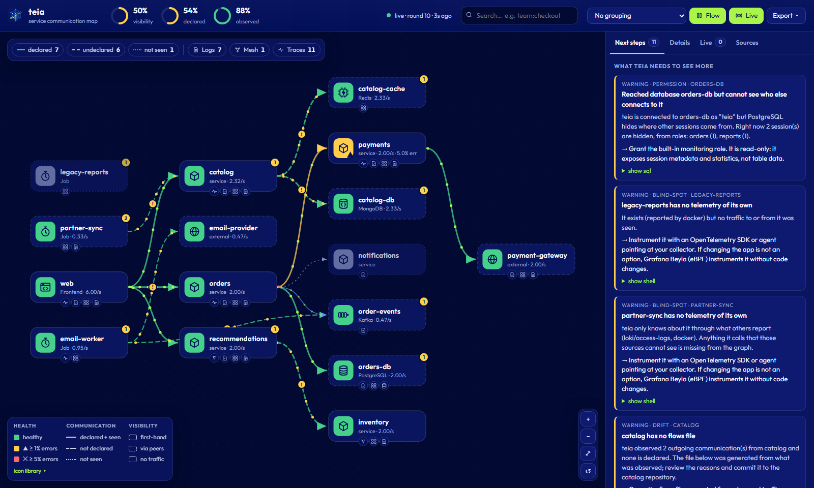
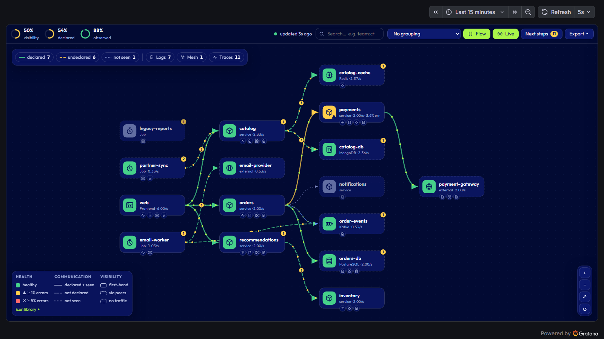
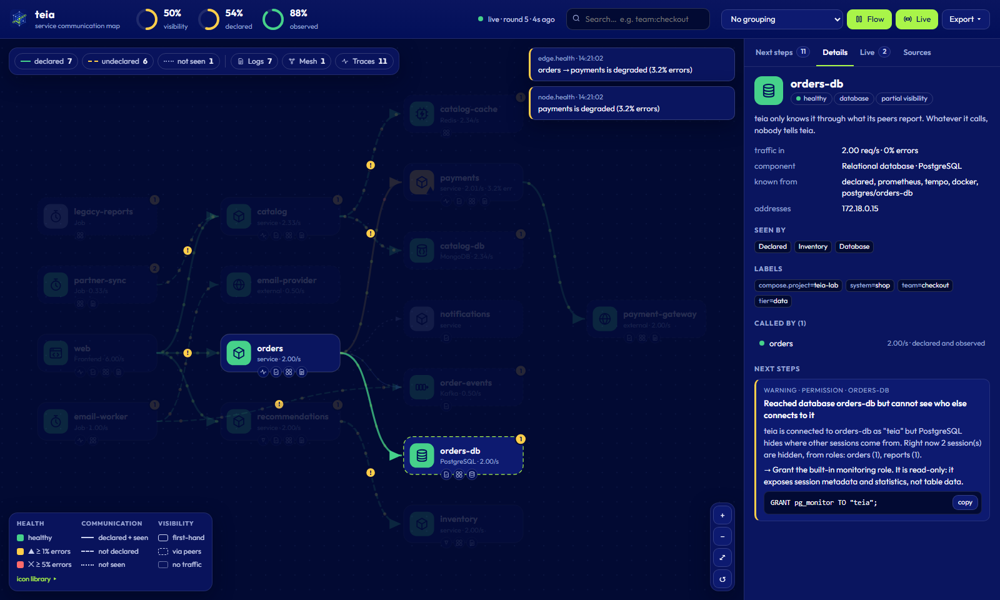
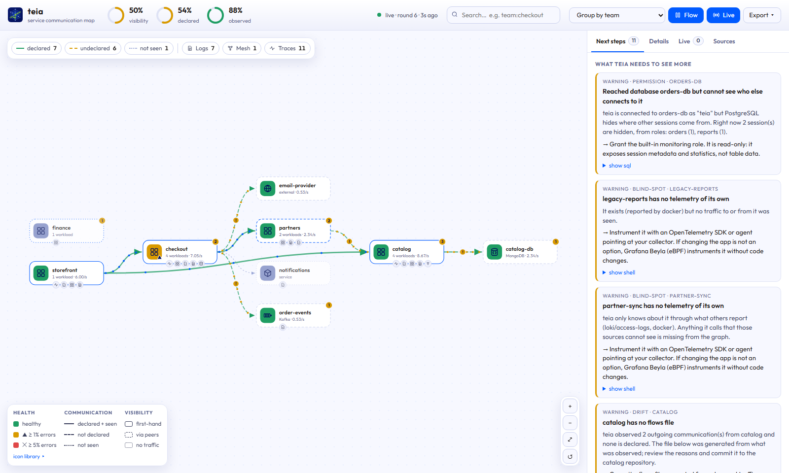
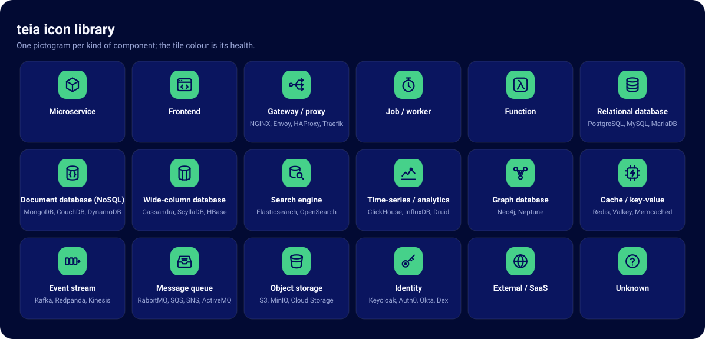
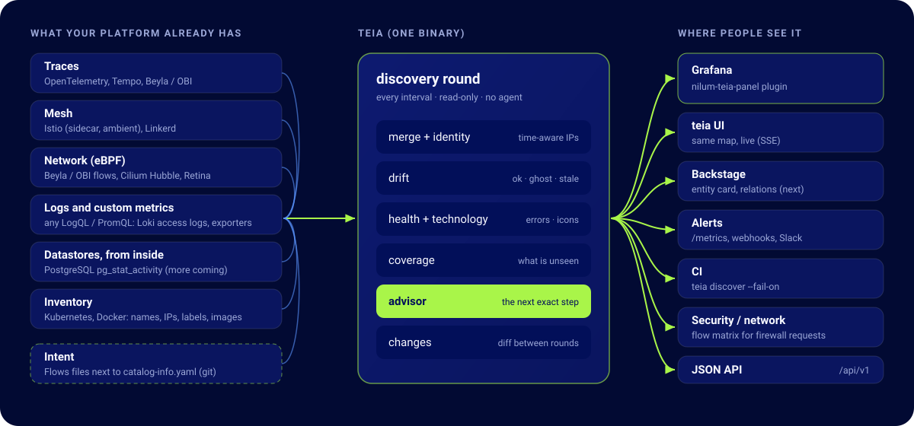

<p align="center">
  <picture>
    <source media="(prefers-color-scheme: dark)" srcset="docs/assets/logo-dark.svg">
    
  </picture>
</p>

<p align="center">
  <a href="https://github.com/nilum-br/teia/actions/workflows/ci.yml"></a>
  <a href="LICENSE"></a>
  <a href="go.mod"></a>
  <a href="plugins/grafana"></a>
</p>

**Seu diagrama de arquitetura está mentindo em algum lugar. A teia mostra onde, e o que fazer.**

A teia mapeia quem fala com quem na sua plataforma a partir da telemetria que você **já tem**: traces, métricas
de mesh, fluxos eBPF, logs de acesso e os próprios bancos. Depois compara com o que os times *declararam*. E,
diferente de um mapa de serviços comum, diz exatamente onde está cega e qual permissão, adaptador ou
instrumentação faria ela enxergar mais. Roda como um binário só em Linux, macOS e Windows, e aparece onde o time
já olha: no **Grafana**.

[English](README.md)



## Por quê

Mapa de serviços virou commodity. Nenhum deles responde:

- **Drift**: que comunicações acontecem sem ninguém ter declarado, e quais declaradas nunca acontecem?
- **Cobertura**: quanto do quadro eu **não** estou vendo, e o que exatamente resolve?
- **Contrato**: onde está a lista revisada de "A pode chamar B na porta X, porque Y"?

O **advisor** vai "fiando a teia": a cada rodada aponta o próximo ponto cego e o passo concreto (o `GRANT`, o RBAC,
a instrumentação) para enxergá-lo.

## Agnóstica de propósito

- **Não precisa de service mesh nem de agente novo.** Mesh é um sinal entre vários; veja [docs/sources.md](docs/sources.md).
- **Detecção automática:** apontada para o Prometheus, encontra sozinha métricas de service graph, Istio, Linkerd, Beyla/OBI, Hubble e Retina (10 presets). O `teia detect` mostra o que a plataforma oferece e gera um `teia.yaml` inicial.
- **Qualquer outra coisa** vira aresta com uma query PromQL ou LogQL e um mapeamento de labels.
- **Ambiente misto é o normal:** parte com Istio, parte com OpenTelemetry, parte sem nada. Cada aresta registra quais sinais a viram.
- **Identidade confiável:** IPs são resolvidos pelo inventário, e IP reciclado nunca é atribuído ao workload errado.

## O que você vê

O mapa, no Grafana (`nilum-teia-panel`) ou na interface da própria teia, é o mesmo componente:



- **Saúde:** cada card fica verde, amarelo ou vermelho pela taxa de erro.
- **Tráfego andando:** pontos percorrem cada comunicação na velocidade do tráfego; pontos vermelhos são erros. Ao vivo.
- **Drift e visibilidade:** tracejado é não declarado, pontilhado é declarado e não visto; a borda do card diz o quanto a teia vê em primeira mão.
- **[Biblioteca de ícones](docs/icons.md) padronizada:** microsserviço, banco relacional, banco de documentos (NoSQL), cache, stream (Kafka), fila, gateway, job, SaaS externo. A tecnologia é detectada pelos spans, pela imagem ou por label.
- **Labels:** agrupe por `team`, `system`, `k8s.namespace` ou qualquer label; busque com `team:checkout`, `tech:kafka`.
- **Próximos passos, feed ao vivo e exportação** (PNG, SVG, matriz de fluxos em CSV para pedido de firewall).
- **Teclado e leitor de tela:** todo card e controle é alcançável com Tab; `F` enquadra, `/` busca e `Espaço` liga e desliga a animação, que também segue a preferência de movimento reduzido.

| Clique em qualquer coisa para ver a história e o próximo passo exato | Agrupe por qualquer label, no tema escuro ou claro |
|---|---|
|  |  |

As visões viram links compartilháveis: `?group=team`, `?q=kind:database`, `?select=orders-db`, `?theme=light`, `?flow=1`, `?legend=icons`.

<p align="center"></p>

As mudanças também saem por **webhook** (JSON ou Slack) e **métricas Prometheus** (`/metrics`) para alerta.

## Como funciona

<p align="center"></p>

A teia só lê e não guarda banco de dados: a cada intervalo pergunta a cada fonte o que ela viu, junta as respostas
num grafo com identidades estáveis, compara com os flows declarados, calcula saúde e cobertura e pergunta ao
advisor o que deixaria o quadro mais completo. O resultado sai como JSON, stream ao vivo, métricas e webhooks.

## Testar em 5 minutos

Só precisa de Docker (Linux, macOS ou Windows):

```sh
docker compose -f lab/compose.yaml up -d --build
```

| O quê | Onde |
|---|---|
| **Grafana com o painel da teia** | http://localhost:3480/d/teia-overview |
| Interface da teia | http://localhost:8480 |
| Prometheus | http://localhost:9480 |

```sh
docker compose -f lab/compose.yaml exec teia teia discover          # o que a teia vê e o que falta
docker compose -f lab/compose.yaml exec orders-db psql -U postgres -d orders -c 'GRANT pg_monitor TO teia;'
docker compose -f lab/compose.yaml exec teia teia discover          # o job legado escondido aparece
docker compose -f lab/compose.yaml exec teia teia export matrix --lang pt-BR --declared-only
docker compose -f lab/compose.yaml run --rm e2e                     # o teste ponta a ponta que o CI roda
```

Atrás de proxy com inspeção TLS? Coloque a CA como `.crt` em `certs/` antes do build.

## Instalar

- **Pelo código-fonte** (hoje): `go build ./cmd/teia` (Go 1.27+).
- **Releases** (a partir da primeira tag): binários para Linux, macOS e Windows (amd64, arm64), imagem multi-arch em `ghcr.io/nilum-br/teia` e o zip do painel do Grafana.

Depois, `teia detect` mostra o que a plataforma oferece e gera um `teia.yaml` inicial, e `teia serve` sobe a API e
a interface. Antes de expor a API além do localhost, configure `auth.token` (e `cors.allowedOrigins` para o modo
direto do painel do Grafana): veja [Configuração](docs/configuration.md).

## Documentação

[Sinais e fontes](docs/sources.md) · [Configuração](docs/configuration.md) · [Arquitetura](docs/architecture.md) ·
[Regras do advisor](docs/advisor.md) · [Ícones](docs/icons.md) · [Especificação dos flows](docs/flows-spec.md) ·
[Roadmap](docs/roadmap.md) · [Panorama](docs/landscape.md)

## Contribuir e licença

Issues e PRs são bem-vindos; veja o [CONTRIBUTING.md](CONTRIBUTING.md). Vulnerabilidades devem ser reportadas em
privado, como descrito no [SECURITY.md](SECURITY.md). Apache-2.0. Feito pela [Nilum](https://nilum.com.br) e contribuidores.
