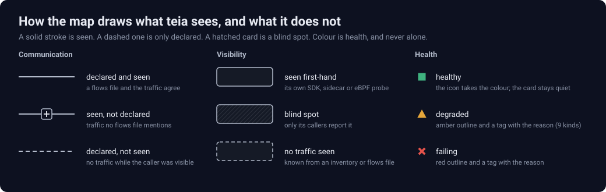

# The map's visual language

teia is a tool people read during an incident, so its look follows one rule: **every mark means something, and the
map says the same thing inside Grafana as on its own page.** Fonts and surfaces change with the host (Grafana's
font and theme inside a dashboard); the grammar below does not.

## The grammar

| Mark | Means |
|---|---|
| Solid line | Declared in a flows file and seen in traffic |
| Solid line with a **+** in the middle | Seen in traffic, declared nowhere: add it to a flows file, or ask why it exists |
| Dashed line | Declared, but no traffic seen while the caller was visible |
| Solid card | Seen first-hand: its own SDK, sidecar, eBPF probe or database explorer reports it |
| Hatched card | A **blind spot**: only its callers report it, so whatever it calls is invisible |
| Dashed card | Known from an inventory or a flows file, no traffic seen |
| Icon color, triangle, cross | Health: healthy, degraded, failing. Amber and red never mean anything else |
| Tag on a card or line | Why it is amber or red, with the number that crossed the rule |

The **plan line** at the top of the page counts the same marks, like a diff: declared and seen, seen but not
declared, declared but not seen, blind spots. Each count is a button that shows only those.

**Compare snapshots** draws the two captures side by side with the same grammar and writes the differences on
the names, like tracked changes: underlined is only after, struck through is only before, and `~` changed. What
differs keeps a heavy outline; what did not change is muted. The "+" and the dashes keep their meaning there too.

## Rules for changes

- Color is for health, selection and focus. Health is a component's, teia's own (its connection, a failed
  request) or a finding's severity; a pause, a count or a new call is not health. A new state gets a shape or a
  stroke before it gets a color, and it goes in the legend.
- Dashed means "only declared" everywhere; hatched means "teia cannot see inside"; a dot is a unit of work. Do not
  reuse them for anything else.
- The marks that carry the grammar (the hatch, the dashed card, the dashed line) keep 3:1 against the surface under
  them in every theme, Grafana's included, so they do not depend on good eyesight or a good screen.
- The map stays where people last saw it. A new round moves no card when a call appears or goes away, and a new
  component takes a free row instead of pushing others; only another view (filters, grouping, an investigation)
  or **Reset** lays the map out again. Two captures compared side by side share one layout.
- One sans-serif family, tabular numbers, small radii (6 px on cards, 1 px inside icons).
- No decorative motion, glow, blur, gradients, dot-grid backgrounds, uppercase eyebrow labels, colored side
  stripes or icons in colored tiles. The traffic dots move only when **Flow** is on, and Flow starts off when the system asks for reduced motion.
- Text says what, from where and since when. A blind spot is written as what teia cannot see, why, and how to
  see it. In the details every value and every reason carries one line in one form, naming only the sources that
  report it: "From prometheus (traces) and loki/access-logs (logs), the 2 min to 21:27:39."
- Icons follow the [icon library](icons.md#drawing-a-new-icon) rules.
- Check a change on the standalone page and in the Grafana panel, light and dark, desktop and mobile.

`internal/api/design-rules.test.mjs` checks the rules a stylesheet can break: health colors only on health states,
dashes only on what is only declared, none of the excluded decoration, and the grammar's contrast in every theme.
