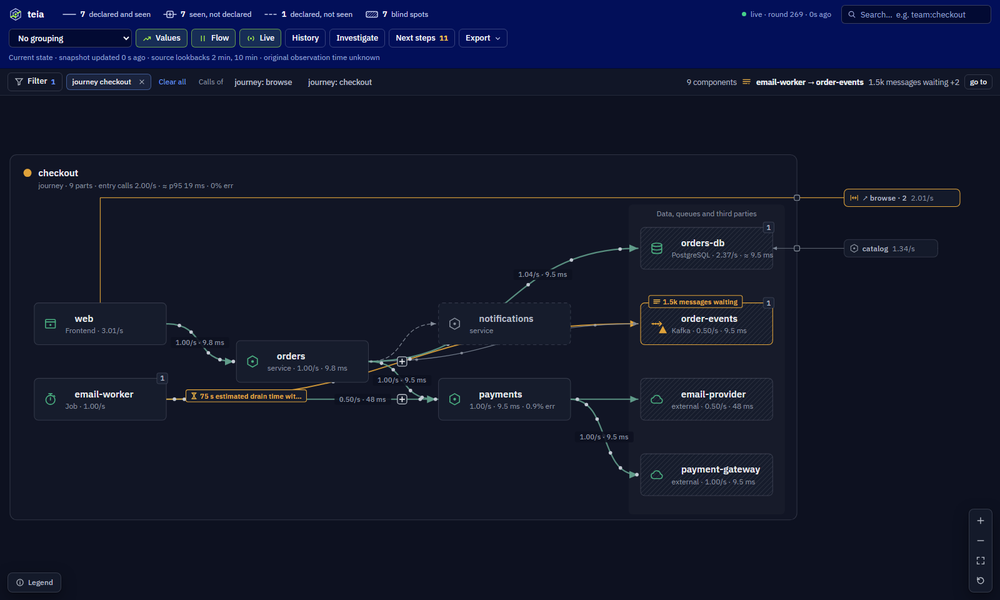
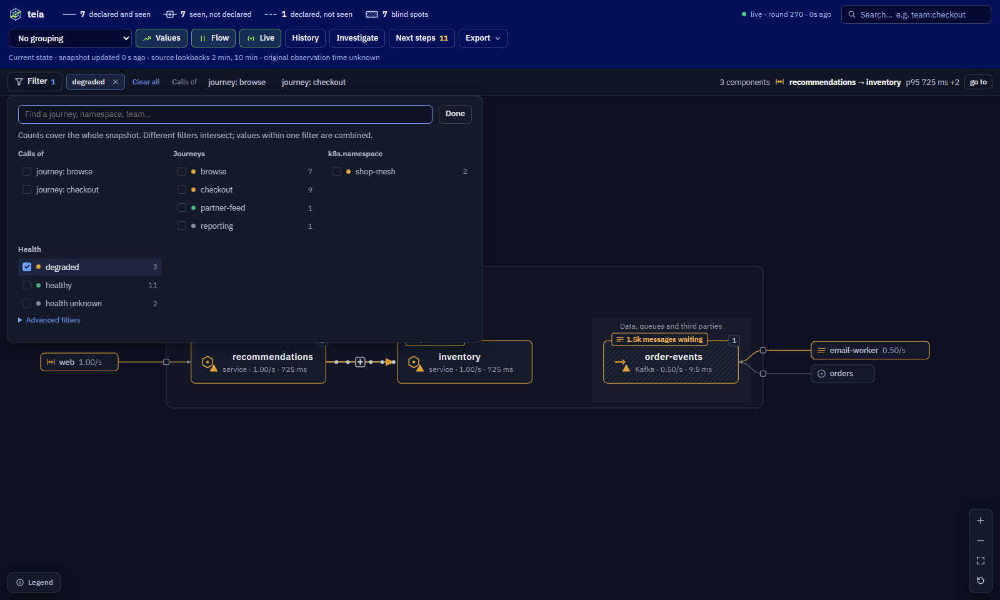

# Journeys and filters

A whole map answers "who talks to whom". During an incident or a review, people ask a narrower question: *what
does checkout go through, and why is it red?* teia can show one journey, or any slice of the map, on its own:

- the services that take part in it are drawn inside a **frame**;
- whatever lies outside the frame is drawn as a **port** at its edge.



## Telling teia which journeys a service takes part in

Nothing needs adding if your services already carry one of these labels. teia uses the first one it finds:

| Label | Where it comes from |
|---|---|
| `journey` | teia's own label |
| `app.kubernetes.io/part-of` | Kubernetes' recommended label: "the name of a higher level application this one is part of" |
| `system` | Backstage's system |

To use another label, set it with the panel's **Journey label** option or `?journeyKey=` on teia's page.

A service on several journeys lists them, separated by commas:

```yaml
# Docker Compose (add these labels to your existing services)
services:
  orders:
    labels:
      journey: checkout
  web:
    labels:
      journey: "checkout,browse"
```

```yaml
# Kubernetes (pod template labels)
metadata:
  labels:
    app.kubernetes.io/part-of: checkout
```

Datastores, queues and third parties need no label: they join the journeys whose services call them.

Kubernetes label values cannot contain commas; structured metadata belongs in an
[annotation](https://kubernetes.io/docs/concepts/overview/working-with-objects/annotations/). For multiple
memberships, put a JSON array on the **pod template**, alongside any existing labels:

```yaml
spec:
  template:
    metadata:
      labels:
        app.kubernetes.io/part-of: checkout
      annotations:
        teia.nilum.io/journeys: '["checkout", "browse"]'
```

The annotation augments the detected journey label; it does not erase it. Names are trimmed, lowercased and
deduplicated. At most 64 names, 128 bytes each, fit in an annotation of at most 8192 bytes. Empty names,
commas, colons, equals signs and control characters are rejected. An invalid annotation produces a finding
without dropping the workload or its legacy label. The newest non-terminating pod supplies workload metadata,
including during rollouts. An explicitly chosen unrelated **Journey label** uses that label instead.

An unlabelled service can be included when reached **downstream** from a member, within the expansion limit.
An unlabelled upstream caller remains a boundary port; leaving it unlabelled does not make it a member of every
journey it calls.

## How a journey is built

1. **Members** are the nodes whose journey label or explicit annotation holds the value.
2. From them, teia follows calls **downstream**:
   - datastores, caches, queues and externals are included, but never walked past, so a shared database's other
     clients do not join the journey;
   - a service labelled with **another** journey is where this one leaves;
   - unlabelled services are followed up to two hops past the last member;
   - a scope contains at most 200 nodes, including explicit members. Nodes and outgoing targets are processed
     in stable ID order. A depth or size limit sets `truncated: true`; boundary connections remain visible.
3. The **headline** is the journey's worst health and the reason that most likely causes it. It shows on the bar
   above the map, for example `orders → payments · 4.1% errors`. When a reason only passes on a dependency's
   problem, the reason it points at wins, and a line wins over a node.

## The frame and its ports

Inside the frame, the journey reads left to right:

- the services the outside calls into start it;
- its datastores, queues and third parties end it, in one lane;
- the frame's header gives its name, its health and what enters it (traffic, p95 and errors).

The header counts **entry calls**, including fan-out from entry services; it does not count unique user
transactions. Its health is the worst health in the scope, including dependencies, while its traffic/errors
describe entry edges. Successful entry calls can coexist with an unhealthy downstream dependency.

Errors use only measured traffic as their denominator: 100 req/s at 50% errors plus 900 req/s with unknown
errors reads **50% errors, 10% covered**, never an unqualified 5%. All-unknown inputs remain unknown.
Latency combines available entry-edge percentiles using measured traffic weights. Multiple inputs carry
`≈ p95` / **p95 approximation** and a coverage qualifier in the details; this is neither a percentile of the
combined distribution nor end-to-end journey latency. Zero-rate samples cannot contribute a traffic weight.
Prometheus presets aggregate compatible histogram buckets before quantiles; later merges of different mapped
series or node/group summaries have only percentiles available and are marked approximate.

The time row distinguishes current state from query data. Collection time, source lookback and original
observation time are separate; unavailable timestamps stay unknown. The Grafana picker does not turn Teia's
current snapshot into history. See the [frame/time contract](../plugins/grafana/README.md#time-and-evidence-contract).

Everything outside the frame becomes a port, a small chip beyond its edge:

| Port | Side | What it is |
|---|---|---|
| **Caller** | left | a service outside calling into the journey |
| **Exit** | right | where the journey leaves to, one chip per journey it reaches (`↗ browse · 2`) |
| **Tenant** | right, beside the datastore | another client of a datastore, queue or third party in the journey: its traffic counts in their health |

Each port carries the traffic and the health of the calls it stands for. Its line runs straight into the frame
when nothing is in the way, and along the frame's top or bottom edge otherwise, so it never crosses a card. Past
eight ports on a side (five in a Grafana panel), the quietest fold into one "+N more" chip. Click a port to see who
is outside, open their journey, or find them on the whole map.

## Filters

Journeys are one kind of filter. The **Filter** button (key `J`) opens every way the map can be narrowed, with how
many components hold each value and the worst health among them:

- journeys;
- every label your services share: `k8s.namespace`, `team`, `tier`, `compose.project`…;
- health, kind of component and technology;
- the communication itself: declared and seen, not declared, declared but not seen;
- which signal saw it: traces, metrics, logs, inventory.



Values of one filter add up (namespace `shop` **or** `billing`); different filters narrow each other (namespace
`shop` **and** failing). Each filter in use shows as a chip on the bar, removed with ✕. Any filtered view gets a
frame and ports like a journey's, and keeps its own layout when you move cards.

With no filter in use, the bar lists the journeys with their health, one click away.

The search box narrows too: type and press **Isolate** (`Shift+Enter`).

| Search | What it shows |
|---|---|
| `checkout` | the journey checkout |
| `team=payments` (or `team:payments`) | the components labelled `team=payments` |
| `orders` | orders and everything it depends on |
| `from:orders` | the same, written out |

## Sharing a view

On the standalone page, the filters go in the address bar, so a view is a link:

- `?journey=checkout,browse` shows both journeys;
- `?filter=k8s.namespace:shop,health:failing` keeps what both say;
- `?journeyKey=team` names journeys after the `team` label.

In Grafana, the panel's **Journey** option takes a value or a dashboard variable such as `${journey}`. "All", or a
variable left unresolved, shows the whole map. The lab dashboard has a Journey variable.
Selections made on the panel itself are remembered locally per dashboard/panel; they do not automatically update
the dashboard variable or make every filter shareable. A dashboard link can explicitly set `var-journey=checkout`.

## API contract

`GET /api/v1/journeys` and the `journeys` property of the snapshot and graph expose the same version 1 contract:

```json
{
  "version": 1,
  "mode": "ownership",
  "key": "journey",
  "maxDepth": 2,
  "maxNodes": 200,
  "scopes": [{
    "name": "checkout",
    "key": "journey",
    "roles": {"orders": "member", "db": "dependency"},
    "entryPoints": ["orders"],
    "entryEdges": ["web->orders"],
    "boundaryPorts": [{"kind": "caller", "edgeId": "web->orders", "from": "web", "to": "orders"}],
    "health": "unknown",
    "truncated": false
  }]
}
```

Entry points are included services without an incoming connection, plus non-resource nodes reached from
outside. A cycle with no outside caller has no invented entry point. `entryEdges` follows the entry-call rule
above; declared connections may be included but do not create measured traffic. `boundaryPorts` lists each
crossing connection before visual folding. `roles`, rather than an upstream reachability guess, defines membership.
The example is illustrative: all referenced nodes and connections must exist in the accompanying snapshot.

The engine computes the default scope once per discovery round. Grafana node rows carry explicit memberships
in the JSON `journeys` column and the complete JSON `journeyContract` on the first node row. The panel preserves
that contract when all referenced nodes and connections are present. Generic Node Graph frames, old servers,
custom label filters and `from:node` exploration use the compatible local fallback; they do not gain trace
correlation. `GET /api/v1/journeys?key=team` computes a custom label contract for API consumers.

The shared [acceptance fixture](../internal/journey/testdata/shared.json) is consumed by Go and Grafana tests.
It covers a shared frontend, two journeys, a shared database, unlabelled upstream and downstream services,
cycles, the expansion boundary and missing telemetry. A closed cycle with no entry and the 200-node cap have
additional Go tests.

## Separate operation mode: design contract

A label journey follows **ownership**, not single requests: a service shared by two journeys brings all of its calls.
The rules above keep that in check, and the ports show where the journey touches the rest.

Transaction-level journeys are a separate, **not yet implemented** mode. Before that mode can be enabled, its
API and implementation must satisfy these requirements:

1. Use `mode: "operation"`, an explicit entry service and normalized route/operation, an actual query interval,
   trace IDs and parent/span relationships. Do not derive a route from labels or a raw high-cardinality URL.
2. Include only calls linked to the matched entry span in the same trace. Missing parents, asynchronous links
   and retries need explicit attribution rules; a shared service or database never joins by topology alone.
3. Report sampled root counts, incomplete traces, orphan spans and the known sampling policy separately.
   Without a reliable total denominator, sampling coverage, total request rate and end-to-end coverage remain
   unknown. An observed root duration is sample latency; it is not an aggregate traffic percentile.
4. Keep entry operation errors separate from dependency health. Missing spans cannot establish a healthy
   downstream or a zero error rate. Preserve original evidence timestamps and the actual requested period.
5. Pass the [operation acceptance fixture](../internal/journey/testdata/operation-contract.json): checkout and
   browse traverse the same `web` and `db` services but retain different calls; the incomplete checkout trace
   stays incomplete and the orphan span is not assigned by an ownership label.

Operation scopes, declared journey documents, journey-specific notifications and metrics remain separate
extensions; the ownership contract does not advertise them as implemented features.
